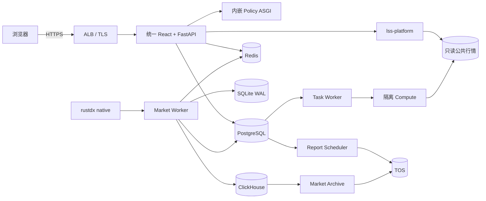

# 系统架构设计

## 1. 状态与边界

- 应用版本：`0.5.1`
- 当前主线：`main`，提交 `132db778c03b5e4d724afd510c63d269c7764211`
- 发布标签：`v0.5.1-rc.1`
- 生产入口：<https://shanao.asia>
- 部署平台：火山引擎 VKE，命名空间 `banxia`
- 业务边界：A 股研究、筛选、监控、回测、复盘和报告；不连接券商，不自动下单

本文只描述当前架构。历史 Kafka/Flink、独立 Policy API、SSE Gateway、独立 LSS
PostgreSQL 和 DinD 拓扑已从现行文档移除，回溯时使用 Git 历史和不可变发布记录。
详细组件参数见 [v0.5.1 精简生产架构](36-lean-architecture-v0.5.1.md)，实际部署状态见
[全新安装发布记录](releases/2026-10-19-fresh-install-v0.5.1.md)。

## 2. 总体拓扑

核心原则：

1. 浏览器只访问统一域名和统一 FastAPI。
2. Policy 通过进程内 ASGI Transport 调用，不经过集群 HTTP Bridge。
3. Market Worker 以“SQLite WAL + 至少一次处理 + 幂等写入”完成实时链路。
4. PostgreSQL、ClickHouse 和 TOS 保存权威事实；Redis 仅保存可重建投影。
5. API 与后台任务独立扩缩容，API 副本不会重复启动任务消费者。
6. Compute 无业务密钥、禁止出网、只读根文件系统和公共行情。
7. 数据不完整、过期或依赖异常时 fail closed，不输出有效入场判断。

## 3. 运行单元

| 工作负载 | 副本 | 职责 |
| --- | ---: | --- |
| `lss-product` | HPA 2～4 | React、统一 API、账户、多租户、SSE、Policy 门面 |
| `lss-task-worker` | 1，Recreate | 监督研究、实时规则、通知和定时任务 |
| `report-scheduler` | 1，Recreate | Policy 刷新队列、历史任务、报告调度和补跑 |
| `lss-platform` | 1 | 公共行情版本、平台配置和只读行情接口 |
| `lss-compute` | 1 | 回测、优化和研究计算，固定并发 |
| `market-collector` | 2，租约单活 | rustdx 采集、WAL、特征、状态机和投影 |
| `market-reference-sync` | 1 | 证券、板块、行业和交易日参考数据 |
| `intraday-monitor` | 1 | 采集状态、规则评估和告警指标 |
| `market-archive` | CronJob，默认暂停 | 五类 ClickHouse 行情的 TOS 日终归档 |

`market-archive` 已部署候选镜像并通过模块烟测；只有在有效 TOS 凭据和首个有数据交易日
完成手工验收后才能启用。

## 4. 数据职责

| 数据域 | 权威存储 | 说明 |
| --- | --- | --- |
| Policy 策略、计划、状态、任务和审计 | PostgreSQL `banxia` | 事务边界与 Inbox/Outbox |
| 身份、租户、会话和路由 | PostgreSQL `lss_control` | 独立运行角色 |
| 租户业务数据 | PostgreSQL `lss_data_production` | RLS 与独立运行角色 |
| 盘口、分钟线、特征和历史行情 | ClickHouse | 批量、幂等、按日期分区 |
| 最新行情、决策和 SSE 投影 | Redis | 可由权威存储重建 |
| 报告、研究资产和原始归档 | 火山引擎 TOS | 内容寻址、Manifest、SHA-256 |
| 未完成持久化的实时事件 | SQLite WAL / EBS | 每个 Market Worker 独立 |
| 公共行情版本和平台状态 | NAS RWX | Compute 只读挂载 |

三个 PostgreSQL 数据库共用集群但不共用数据库和运行角色。管理员 DSN 仅进入离线
初始化 Job，API 和 Compute 均不获得管理员凭据。

## 5. 实时处理

单条行情事件按以下顺序处理：

1. rustdx 返回的数据经过代码、单位、日期和时间标准化。
2. 规范化事件先写入当前 Market Worker 的 SQLite WAL。
3. 原始行情幂等写入 ClickHouse，并更新 Redis 行情投影。
4. 进程内确定性计算实时特征，结果写入 ClickHouse 和 Redis。
5. 每个有效计划在 PostgreSQL 事务内写 Inbox、决策状态、事件和 Outbox。
6. 内嵌 Relay 将 Outbox 更新到 Redis 决策投影。
7. 所有权威写入成功后确认并删除对应 WAL 记录。

WAL 重放由稳定 `event_id` 和 PostgreSQL 唯一键去重。Redis 故障不回滚已提交的权威
状态；恢复后从 PostgreSQL、ClickHouse 和 Outbox 重建。

## 6. 请求与任务流

- 普通 Web 请求由 `lss-product` 认证、授权并查询权威存储或投影。
- `/api/policy/*` 由统一权限层校验后转入同进程 Policy `/api/v1/*`。
- SSE 使用短期一次性票据；私有事件先持久化，再通过 PostgreSQL 通知和游标补扫恢复。
- API 只登记持久任务；`lss-task-worker` 和 `report-scheduler` 负责领取、租约和终态。
- Task Worker 通过集群内 TCP 向 Compute 发送固定 JSON 行协议任务。
- Compute 使用服务传入的 `DATA_DIR` 读取指定公共行情版本，私有中间结果只写临时目录。

## 7. 一致性与故障边界

| 故障 | 行为 |
| --- | --- |
| rustdx 节点失败 | 切换备用节点，记录缺口和恢复时间 |
| Market Worker 重启 | 重放本 Pod WAL；旧主卷保留待核销 |
| PostgreSQL 不可写 | 停止新决策，不允许只写 Redis |
| ClickHouse 不可写 | WAL 保留；历史查询和归档降级 |
| Redis 丢失 | 权威状态不丢失，投影重建 |
| TOS 不可用 | 报告/归档任务失败并重试，不发布成功 Manifest |
| Compute 异常 | 任务进入受控失败或中断状态，不泄露凭据 |
| SSE 断连 | 客户端重查 REST 权威状态后重新换票 |

## 8. 安全边界

- 公网只开放 ALB 443，数据库、缓存、平台和 Compute 均为集群内服务。
- Cookie 使用 `Secure`、`HttpOnly` 和 `SameSite`，写请求执行同源/CSRF 校验。
- Compute 不注入数据库、SMTP、TOS 或平台管理 Secret，NetworkPolicy 拒绝出站。
- 应用容器非 root、删除 Linux capabilities，不挂载宿主 Docker Socket。
- Secret 不进入镜像、ConfigMap、日志、浏览器或验收产物。
- 归档和邮件配置通过交互式工具写 Secret；实际对象读回和收件箱到达分别验收。

## 9. 扩展阈值

当前架构按不超过 200 只动态监控股票设计。只有满足以下任一条件并有压测证据时，
才评估重新引入 Kafka：

- 持续事件量超过 `10,000 events/s`。
- 出现三个以上相互独立的实时消费域。
- 需要超过 24 小时的在线事件重放。

只有窗口计算无法在 Market Worker 资源预算内稳定完成，或出现多作业共享状态，
才评估重新引入 Flink。不能仅凭预期增长增加常驻中间件。

## 10. 当前验证边界

已验证：固定 digest 部署、HTTPS、登录、九项菜单、SSE、空库初始化、管理员工作空间、
冷快照、Compute 实际执行和归档模块烟测。

待完成：有效 TOS 凭据下的对象写入/读回、SMTP 真实投递、首个有数据交易日归档、
完整行情覆盖、生产真实有信号回测、容量和恢复演练。
