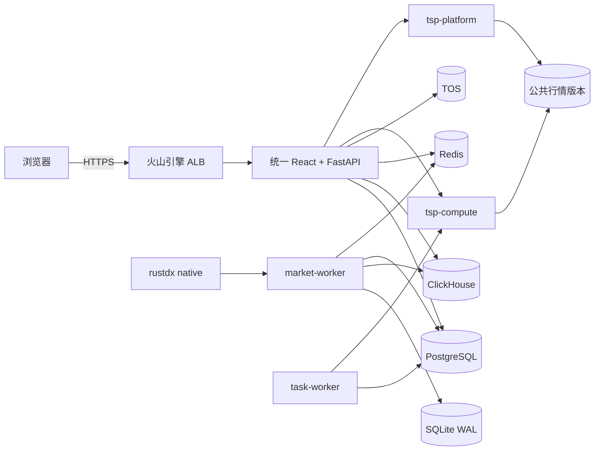

# 当前生产技术方案

## 1. 状态与口径

- 仓库当前版本：`v0.5.1`。
- 架构状态：按全新环境发布，等待 amd64 镜像和生产验收，不恢复旧业务数据。
- 生产入口：<https://shanao.asia>。
- 行情来源：`rustdx native`。
- 服务范围：行情研究、策略筛选、盘中监控、回测与报告；不连接券商账户，不自动下单。

本文描述仓库中下一次生产发布的唯一目标拓扑。线上实际状态在发布门禁完成前仍以最近一次
验收记录为准，不得因源码已合并而宣称生产已生效。`v0.5.0` 的 Kafka、Flink、MinIO、
独立 Policy API 和 DinD 拓扑仅保留在发布记录、资源盘点和 Git 历史中。

详细设计见 [v0.5.1 精简生产架构](36-lean-architecture-v0.5.1.md)，发布步骤见
[部署与运维](06-deployment-operations.md)。

## 2. 总体架构

核心原则：

1. 浏览器只访问统一产品域名和统一 FastAPI。
2. Policy 作为同进程领域模块运行，`/api/policy/*` 外部契约保持不变。
3. 当前不超过 200 只动态监控股票的实时链路由单一 Market Worker 完成。
4. WAL、PostgreSQL Inbox/Outbox 和稳定事件 ID 保留可靠投递与幂等语义。
5. PostgreSQL、ClickHouse 和 TOS 是权威存储，Redis 仅保存可重建投影。
6. 私有计算在无凭据、禁止出网、只读根文件系统的独立 Pod 中执行。

## 3. 生产工作负载

### 3.1 常驻服务

| 工作负载 | 副本 | 职责 |
| --- | ---: | --- |
| `tsp-product` | HPA 2～4 | React、统一 API、账户、多租户、SSE、内嵌 Policy |
| `tsp-task-worker` | 1 | 独立监督研究、规则、通知和定时任务 |
| `report-scheduler` | 1 | Policy 持久任务队列、定时报告与补跑 |
| `tsp-platform` | 1 | 公共行情版本、平台配置和只读行情接口 |
| `tsp-compute` | 1 | 隔离执行回测、优化、挖掘等计算任务 |
| `market-collector` | 2，租约单活 | 容器内运行 `market-worker`，负责采集、特征、决策与投影 |
| `market-reference-sync` | 1 | 证券目录、板块和每日参考数据同步 |
| `intraday-monitor` | 1 | 采集指标、规则计算和告警暴露 |

`tsp-product` 每个 Pod 只运行统一 API。Task Worker 独立监督四类子进程，
子进程异常退出会使 Worker 容器失败，由 Kubernetes 重建；API 扩容不复制任务进程。

### 3.2 定时任务

| 工作负载 | 职责 |
| --- | --- |
| `limit-up-history-sync` | 增量同步涨停历史 |
| `paper-trading-1650` | 结算冻结规则的模拟样本 |
| `stock-history-sync` | 增量补齐历史行情 |
| `board-capital-sync` | 更新板块资金数据 |

### 3.3 发布与初始化任务

| Job | 职责 |
| --- | --- |
| `banxia-schema-migration` | 应用 Policy PostgreSQL 与 ClickHouse 迁移 |
| `banxia-catalog-bootstrap` | 初始化策略目录 |
| `tsp-database-bootstrap` | 在共享 PostgreSQL 创建 TSP 双库和最小权限角色 |
| `tsp-product-initialize` | 应用 TSP 双库迁移、初始化身份并注册生产 Cell |

旧 TSP PostgreSQL 数据迁移使用
`product/deploy/kubernetes/migrate-legacy-postgres.yaml` 手工执行。该文件不会被
Kustomize 自动应用，避免未完成备份和核对时误迁移生产数据。

## 4. 数据与存储

| 数据域 | 生产落点 | 恢复边界 |
| --- | --- | --- |
| Policy 策略、计划、状态、任务、审计 | PostgreSQL `banxia` | 数据库备份与 WAL 归档 |
| TSP 身份、租户和路由 | PostgreSQL `tsp_control` | 独立角色与数据库级恢复 |
| TSP 租户业务数据 | PostgreSQL `tsp_data_production` | RLS、独立角色与数据库级恢复 |
| 盘口、分钟线、特征、历史行情 | ClickHouse | 幂等事件 ID、分区备份 |
| 最新行情、决策和 SSE 投影 | Redis | 从 PostgreSQL 和 ClickHouse 重建 |
| 原始文件、报告和研究资产 | 火山引擎 TOS | Bucket 版本控制、生命周期和哈希校验 |
| 未完成持久化的实时事件 | Market Worker 独立 SQLite WAL | EBS `Retain`，重启后重放 |
| TSP 公共行情版本和租户产物 | NAS RWX | 发布标记、目录备份和只读挂载 |

Policy、TSP 控制库和 TSP 业务库共享同一个 PostgreSQL 集群，但不共享数据库和运行角色。
`tsp_control_runtime`、`tsp_data_runtime` 均禁止 `SUPERUSER`、`BYPASSRLS`、
`CREATEDB`、`CREATEROLE` 和角色继承。

生产对象存储使用 TOS 上海地域 S3 兼容内网端点。代码保留
`BANXIA_MINIO_*` 兼容读取，仅用于旧环境迁移；生产 Secret 使用 `BANXIA_OBJECT_*`。

## 5. 实时行情与决策

单条行情事件按以下顺序处理：

1. `market-worker` 获得 PostgreSQL advisory lease 后从 rustdx 批量采集候选股票。
2. 规范化事件先写入本 Pod 的 SQLite WAL。
3. 原始盘口或分钟线幂等写入 ClickHouse，并更新 Redis 行情投影。
4. 进程内确定性计算实时特征，写入 ClickHouse 和 Redis。
5. 每个有效计划独立执行策略状态机。
6. PostgreSQL 在同一事务中写 Inbox、决策状态、审计事件和 Outbox。
7. Market Worker 内的 Outbox Relay 将决策更新到 Redis。
8. 权威存储成功后确认 WAL；Redis 决策投影失败由 Outbox 保留并重试。

重复事件由 `plan_id + source_event_id` 作用域去重。不可逆放弃状态写入 PostgreSQL，
服务重启和 WAL 重放不会使状态回退。

Kafka、Flink、`market-sink`、独立 `strategy-engine`、独立 `outbox-relay` 和
`projection-worker` 已从当前源码与本地、生产部署退役；历史回滚使用对应 Git 提交和旧镜像。

## 6. Web、API 与计算

### 6.1 统一入口

ALB 只将 `/` 转发到 `tsp-product:80`。独立 SSE Gateway 和独立 Policy Service 均已
移除。API 负责：

- 账户、租户、权限和九项主导航业务。
- `/api/events` 与 `/api/events/ticket` SSE 契约。
- `/api/policy/*` 同源门面。
- React 静态资源与前端路由。

Policy 门面通过 `httpx.ASGITransport` 调用同进程 Policy FastAPI，不经过集群网络，
不需要服务间 Token。内嵌 Policy 的 PostgreSQL、ClickHouse、Redis 和 TOS 客户端由
扩展生命周期统一关闭。

### 6.2 Compute 隔离

API 通过 `tsp-compute:7000` 的 JSON 行协议发送受限任务。Compute Pod：

- 不注入数据库、SMTP、TOS 或平台管理 Secret。
- NetworkPolicy 默认拒绝全部出站，只允许 API 健康探测和 Task Worker 计算入站。
- 只读挂载公共行情版本，根文件系统只读，临时文件写入受限 `emptyDir`。
- 使用非 root 用户、删除全部 Linux capabilities，并限制 CPU、内存和并发。
- 请求不能覆盖入口程序、环境变量、数据目录或资源限制。

该边界用于隔离业务凭据和网络访问，不等同于面向不可信任代码的强多租户沙箱。若未来开放
任意用户代码，需要升级为每任务 Pod、gVisor/Kata 或独立计算账户。

## 7. 网络与安全

- 公网仅暴露 ALB，数据库、缓存、计算和平台 Service 均为集群内地址。
- Namespace 默认拒绝入站，再按组件标签放行。
- `tsp-compute` 明确拒绝全部出站。
- 应用 Pod 不挂载宿主机 Docker Socket，不包含特权容器。
- Secret 不进入镜像、ConfigMap、日志或浏览器。
- 生产镜像必须使用版本 Tag，并在发布前固定 Registry Digest。
- PostgreSQL、ClickHouse、Redis、TOS 和 SMTP 凭据必须分别轮换。

## 8. 可观测性

当前监控重点：

- Market Worker 是否持有租约、最后成功采集时间、行情覆盖率和 WAL 最老事件年龄。
- PostgreSQL、ClickHouse、Redis 和 TOS 健康状态。
- Outbox 未发布数量与最老记录年龄。
- API P95/P99、错误率、SSE 连接数和登录失败率。
- Task Worker 子进程存活、任务队列年龄和失败次数。
- Compute 并发、429、任务时长、超时和异常退出。

Kafka Lag 和 Flink Checkpoint 指标只属于旧链路，不得作为 `v0.5.1` 生产就绪条件。

## 9. 发布门禁

本次采用[全新安装流程](06-deployment-operations.md#4-本次全新安装)，不执行下列
旧数据备份与迁移项。必须验证空库初始化和公网访问；TOS 或 SMTP 未配置时记录真实限制，
不能宣称报告归档、验证码与邮件找回已通过。下列迁移门禁仅适用于保留数据升级。

以下条件全部满足后才能切换生产：

1. Policy、TSP 后端、前端、版本契约和 Kustomize 渲染测试通过。
2. 三个生产镜像构建成功、完成漏洞扫描并固定 Digest。
3. PostgreSQL、ClickHouse、旧 MinIO/NAS 完成备份。
4. 旧 TSP PostgreSQL 双库迁移后完成表数、行数、登录和关键业务抽样核对。
5. MinIO 到 TOS 完成对象数、总大小和 SHA-256 核对。
6. 生产 Secret 不含示例值，数据库运行角色通过权限审计。
7. 服务端 dry-run 无待删除的数据卷、Secret、ALB 或 StorageClass。
8. 发布后完成健康、登录、九项菜单、Policy、SSE、SMTP、行情、报告和 Compute 验收。
9. 验收后删除旧工作负载和 Service，但保留旧 PVC/Bucket 至少五个交易日。
10. 观察期与恢复核对完成后，才允许审批回收旧存储。

## 10. 回滚

回滚必须以数据一致性为前提：

1. 保留 `v0.5.0` 镜像 Digest、旧 TSP PostgreSQL PVC、旧 MinIO 卷和迁移前备份。
2. 停止新版本写入，记录切换时间并备份切换后的增量数据。
3. 核对共享 PostgreSQL、TOS 和旧存储间的增量差异。
4. 恢复旧工作负载前确认同一数据域只有一个写入者。
5. 若恢复 Kafka/Flink 链路，先停止 Market Worker并核对 WAL 与 Outbox。
6. 回滚后重新执行登录、行情、计划、实盘、报告和任务队列验收。

不得通过删除共享 PostgreSQL、ClickHouse、NAS、PVC、PV、Secret、ALB 或 StorageClass
实现应用回滚。
