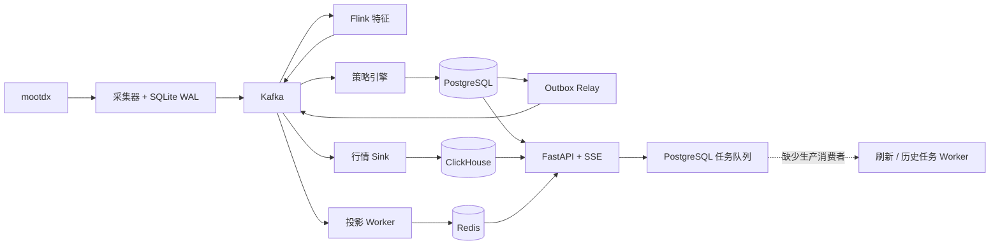

# 技术架构审计与改进建议

审计日期：2026-10-14。源码基线：`3db6f0d`。范围包括当前仓库、渲染后的 VKE 清单，以及生产工作负载和 PostgreSQL 控制数据的只读查询。未执行部署、故障注入、压测或恢复演练。

## 1. 架构判断

现有组件分工基本合理：mootdx 提供市场事实，Kafka 传递实时事件，Flink 计算特征，PostgreSQL 保存策略状态与任务，ClickHouse 保存行情历史，Redis 提供投影，MinIO 保存文件和检查点，FastAPI 提供查询。Inbox/Outbox、持久 WAL、策略参数版本和可重建缓存是可以保留的基础。

主要缺口集中在消息失败处理、任务实际执行、发布一致性和数据时效。部分功能虽然有源码和数据库队列，却没有生产消费者；部分可靠性要求写在文档中，运行代码尚未实现完整约束。近期改进以数据服务继续单副本为前提，先提升正确性、可恢复性和可观察性，再根据负载与恢复目标决定是否增加副本。

## 2. 已核实的生产状态

以下状态来自本次实际查询，不沿用旧验收快照。[cite:1](#source-1)

| 项目 | 本次观察 |
| --- | --- |
| API | 2 个就绪副本，镜像标签 `dashboard-20261006-r5` |
| 采集器、行情 Sink、策略引擎、Outbox、Redis 投影 | 各 2 个就绪副本，镜像标签 `f65154b` |
| 参考数据同步 | 1 个就绪副本，镜像标签 `f65154b` |
| Flink | 1 个 JobManager、2 个 TaskManager 就绪；标签 `59f59a6` |
| PostgreSQL、Kafka、ClickHouse、Redis、MinIO | 各 1 个就绪副本 |
| 报告、涨停档案、模拟盘 CronJob | 镜像标签 `f65154b` |
| PostgreSQL 迁移记录 | 001 至 020；未记录 021、022、023 |
| 报告刷新任务 | 9 个 queued；最早创建于 2026-10-08 |
| 策略历史任务 | 5 个 queued；最早创建于 2026-10-01 |
| 模拟盘活动 | 仅 `first-board-positive-v1`，running，已结算 0/30 |
| 任务消费者 | 当前工作负载清单没有 `report-scheduler` |

Pod 就绪只能证明探针成功，不能证明 Kafka 没有积压、任务有进展或策略事实完整。源码已经推送不代表对应镜像和迁移已部署。当前 `fusion-l7-v1` 和 T+1 修正不能称为生产已生效；这纠正了此前仅依据提交推送就宣称上线的判断。

生产与仓库 overlay 也存在差异：overlay 将应用镜像统一指向市值看板标签，但集群只更新了 API，其他应用仍保留原标签。迁移清单仍只包含 PostgreSQL 001 至 020。[cite:2](#source-2)

## 3. 当前关键链路

报告 CronJob、参考数据同步和模拟盘还会独立访问 mootdx；API 的股票资料和部分历史行情也会直接访问 mootdx。上图省略了这些旁路和文件存储。

## 4. P0：优先处理

### 4.1 任务队列没有生产消费者

API 将页面刷新写入 `job_execution`，领取报告刷新与策略历史任务的代码在 `run_report_scheduler()` 中。`run_api()` 没有启动该消费者，定时 `run_report_worker()` 也不负责领取队列。生产积压与缺少常驻任务服务的事实一致。[cite:1](#source-1)[cite:3](#source-3)

**影响：** 页面显示已接受任务，但缺少持续执行路径；刷新、历史生成和策略调整后的结果更新无法可靠完成。

**建议：** 提取独立 `job-worker` 持续领取刷新和历史任务；定时任务继续负责发起工作。报告与耗时历史任务分队列或分资源配额。加入领取者、租约过期时间、heartbeat 和 attempt token，完成任务时验证领取批次。当前领取逻辑按运行 15 分钟重领，但完成逻辑没有验证领取者或 attempt，长任务并发可能互相覆盖结果。[cite:4](#source-4)

**验收：** 新任务完成、Worker 重启后恢复、历史任务不阻塞刷新、旧 Worker 无法覆盖新批次结果。恢复积压前检查任务是否仍有效，并限制补跑并发。

### 4.2 消费失败后可能越过失败 offset

`KafkaEventConsumer.poll()` 读取消息后推进本地消费位置，`commit()` 按指定消息提交。Worker 失败抛出异常后，外层循环记录异常并继续下一轮 poll。如果同分区后续消息成功并提交，其位置会越过此前失败记录。畸形消息也没有完整的 DLQ 写入路径。[cite:5](#source-5)

**影响：** 文档声明的“至少一次 + 幂等”并未完整落实。ClickHouse 写入失败或策略处理失败后，可能留下未处理消息，却已经提交更高位置。

**建议：** 对失败分区暂停或 seek 回失败位置，先重试原消息；只提交连续成功处理的位置。明确可重试故障与永久坏消息，后者只有可靠写入 DLQ 后才推进 offset。DLQ 增加查询、审计和重放入口。

**验收：** 同分区连续两条消息，第一条存储失败、第二条可成功时，提交位置仍不能跨过第一条。坏消息进入 DLQ 后才放行，重启后能恢复。

本项为代码路径确认的风险，未通过生产故障注入确认曾发生数据丢失。

### 4.3 发布没有形成可核对的整体版本

源码有 021 至 023 迁移，生产迁移清单和数据库记录均停在 020；生产应用镜像不一致。迁移 Job 使用固定名称，重复 apply 不自动重跑。迁移账本只记录文件名，SQL 提交与账本登记分开，没有内容哈希校验。[cite:1](#source-1)[cite:2](#source-2)[cite:6](#source-6)

**建议：** 建立发布清单，记录各服务 Git commit、镜像 digest、事件 Schema、特征版本和迁移哈希；按照“扩展 Schema → 校验迁移完成 → 发布对应服务 → 功能验证”执行。CI 校验迁移文件与部署清单完整性，并区分已知不兼容缺口与有意延后部署。

**验收：** 生产版本接口可对照发布清单；新增功能不能只凭合并代码标记上线；不同服务可保留各自版本，但兼容关系必须明确。

## 5. P1：正确性、性能与恢复

### 5.1 行情与特征缺少统一的时点约束

策略引擎将特征缓存在进程内，主要按交易日合并。报价新鲜度使用 `collected_at - source_time`，没有覆盖消息在 Kafka 排队之后的处理延迟；特征输入时间和过期状态也没有形成严格准入约束。旧消息同日重放时可能继续按历史采集时刻做当前建议。[cite:7](#source-7)

Flink SQL 使用 Kafka metadata timestamp 做窗口时间，输出状态固定为 `fresh`；Python 特征处理器却计算源时间年龄。两种实现语义不一致。Flink 输出没有显式配置 symbol Key，结合两个策略消费者和进程内缓存，不能保证同股票的完整行情、量比和板块特征到达同一实例。[cite:8](#source-8)

**建议：**

- 区分 `event_time`、`collected_at`、`computed_at`、`processed_at`。
- 实时判断检查处理时刻相对源时间的年龄；回放使用单独的回放时钟。
- 按特征分别记录有效期；拒绝使用比目标报价更晚的特征。
- Flink 使用 payload 中的真实市场时间和 revision；输出按 symbol 分区。
- 特征缓存可恢复，并明确多 Topic 的分区归属；仅设置相同 Key 仍不足以替代重启恢复和跨 Topic 时点匹配。
- 分开衡量 1 秒采样周期与决策端到端延迟。当前 10 秒检查点、事务提交和 watermark 会增加特征可见延迟，需实测后选择延迟与投递语义。[cite:8](#source-8)

**验收：** 重放旧行情、特征晚到、跨日、乱序、rebalance 和实例重启都不会产生当前入场建议；缺少必需特征时明确等待。

### 5.2 Redis 投影更新不够原子，日期和版本边界不足

特征投影按 symbol 存储，通过 GET → 合并 → SET 更新。不同消费者同时合并量比和板块特征可能互相覆盖，且没有与策略引擎相同的跨日清空逻辑。报价与决策也没有比较源时间或版本再更新。[cite:9](#source-9)

**建议：** 按交易日、symbol、feature_name 存储特征；Lua 或 CAS 原子比较版本后更新。最新报价比较源时间，最新决策比较权威状态版本。分钟线按 bar_time + revision 替换，避免修订产生重复样本。

**验收：** 并发更新保留两类特征，旧事件不能覆盖新数据，跨日不会继承昨天的首分钟值。

### 5.3 1 秒目标尚缺少完整吞吐和背压设计

采集发布每条事件都会等待 Kafka flush；行情 Sink 每条消息执行一次 ClickHouse insert 和同步 offset commit。策略引擎会为报价构造新版本、审计和 Outbox，即使状态未变化也走持久化路径。当前成本随监控股票数和计划数增加。[cite:5](#source-5)[cite:10](#source-10)

**建议：** 按有界批次写 WAL、发送 Kafka 和插入 ClickHouse；ACK 后再确认对应 WAL 记录；各分区维护连续确认位置。持久化策略关键状态变化和必要审计，按需要记录周期快照。实时盘口与批量历史采集分资源预算，防止历史工作抢占实时连接。

**验收：** 在目标 200 只监控股票下测量采集周期、端到端 P95/P99、Kafka lag、ClickHouse parts、数据库写入和 WAL 最老事件年龄。上述为待测项目，当前报告没有编造吞吐或延迟数字。

### 5.4 端口存活代替了业务进展

多个 Worker 探针只检查 9100 端口。该端口由独立指标线程启动，业务循环卡住仍可能保持探针成功。Worker 内部状态没有完整导出为业务指标；日志格式化器仅保留少量 extra 字段，任务、campaign、交易日和计数信息可能未输出。[cite:11](#source-11)

API Readiness 要求 Kafka 可用，而大部分查询来自 PostgreSQL、Redis 和 ClickHouse。Kafka 故障可能使仍可提供历史和静态查询的 API 全部退出服务。[cite:12](#source-12)

**建议：** 按服务职责检查主循环 heartbeat 和最近成功进展；空闲、节假日、standby 和积压要区分。API 就绪与查询依赖绑定，消息链路故障单独呈现降级状态。补齐业务指标、有限且明确的日志上下文字段和告警。

**验收：** 页面显示停留在旧数据时能告警；队列积压有告警；消费者停转而端口仍在时能被发现；Kafka 故障期间历史查询按能力降级。

### 5.5 单副本方案缺少经过验证的恢复闭环

数据服务和 JobManager 均为单副本，Flink 检查点与业务文件共享单实例 MinIO。仓库没有发现可复现的自动备份和恢复验收流程。不能据此断言云侧没有快照，但 EBS Retain 不能代替数据库备份。[cite:1](#source-1)[cite:13](#source-13)

采集器主备使用各自 WAL，新主不自动接管旧主未发送数据。Flink JobManager 没有 HA 元数据配置，提交 Job 完成后也缺少持续监督作业恢复的机制。[cite:13](#source-13)

**建议：** 在维持单副本的前提下，先确定 RPO/RTO，建立 PostgreSQL 备份与 WAL 归档、ClickHouse 备份、对象存储异地副本及恢复演练。考虑将检查点和归档迁至 TOS。制定旧采集卷恢复和迟到事件处理步骤；为 Flink 提供幂等恢复监督。扩大副本数应在恢复方案和容量测量之后决定。

**验收：** 从独立备份恢复到空环境，核验样本、计划、状态与历史数据；用实际恢复时间证明目标。云侧备份策略和完整可用区故障恢复仍待专项核实。

### 5.6 历史覆盖和派生市值发布缺少完整性门槛

历史回填使用 `(symbol, period)` 的 completed 标记跳过股票，没有记录请求区间、覆盖到哪天或是否有缺口。曾完成一次回填不代表下一次更新仍完整。[cite:14](#source-14)

市值回填从当前证券集合出发；股本事件缺失时使用当前财务快照估算过去。已有 estimated 字段值得保留，但部分股票抓取失败后仍发布聚合结果，没有完整版本切换和质量门槛，可能把覆盖减少展示成市值下降。[cite:15](#source-15)

**建议：** 保存 coverage_start/end、最新交易日、缺失区间、数据修订和上市/退市生命周期。派生结果先写 staging 版本，通过覆盖率和估算占比检查后切换发布指针。历史股本、板块、ST 状态和财务信息标明有效时点及获取时点。

**验收：** 日期延长后自动补新增交易日；失败股票不会被当成永久完成；不完整市值批次不能覆盖最后完整版本。

### 5.7 研究、模拟和实时判断仍存在规则分叉

T+1 修正已经共享退出函数，但模拟盘仍有独立常量、费用、容量和目标价路径。L7 退出函数仅接收价格，不能验证卖出成交量、跌停队列或持仓可卖数量。冻结 config_snapshot 与执行常量不是同一个事实来源。[cite:16](#source-16)

**建议：** 建立共享 ExecutionPolicy 和持仓账本，统一交易日推进、可卖数量、买卖成交代理、涨跌停、各板最小委托量、成本及账户仓位约束。所有执行读取已冻结版本；规则修订开启新验证批次，并记录代码和输入哈希。研究、模拟和人工建议可共享规则，但明确各自的数据与成交证据边界。

**验收：** 同一输入和策略版本在研究与模拟中产生一致判断；缺少可成交证据不直接记已平仓；未完成持仓继续占用资金。

## 6. P2：模块与开发流程

### 6.1 按业务域拆分 API

当前 `api.py` 有 2912 行，路由、认证、报价拼装、历史抓取、查询和指标在同一文件中。股票详情同步请求 mootdx，公司资料失败会使整体详情失败；缓存未命中时 API 还承担历史补采和持久化。[cite:12](#source-12)

建议在同一应用中拆成 auth、stocks、market、strategy、paper、research、jobs routers；数据抓取移到受限后台任务。查询优先服务已发布快照，附带数据时间和状态。保持现有 API 契约，先减少耦合，无需额外增加微服务。

### 6.2 发布与测试覆盖到链路行为

仓库未发现 `.github` CI 工作流；Makefile 提供本地测试和可选集成测试。现有文档还包含“SQLAlchemy/Alembic”选型，实际代码使用 psycopg 与 SQL 文件迁移；旧生产文档未完整反映当前镜像和功能范围。[cite:17](#source-17)

建议加入迁移完整性、发布清单、Schema 兼容和镜像构建检查。重点集成验证失败消息、分区 rebalance、缓存丢失、任务重启、报告文件与数据库发布一致性、交易日和成交代理。文档区分源码可运行、已部署、已验证三个状态，状态由发布证据支撑。

## 7. 建议实施顺序与验收

| 顺序 | 工作包 | 主要验收 |
| --- | --- | --- |
| 1 | 补齐队列 Worker 和发布清单 | 刷新任务完成；历史任务有进展；镜像与 Schema 对齐 |
| 2 | 失败消息重试与 DLQ | offset 不越过失败记录；可审计重放 |
| 3 | 时点、分区归属与投影约束 | 无旧行情建议；并发不丢特征；重启可恢复 |
| 4 | heartbeat、业务指标和备份恢复 | 业务停转能告警；空环境能恢复 |
| 5 | 批量写入和实时/历史隔离 | 目标负载下完成延迟与资源测量 |
| 6 | 历史完整性、共享执行模型、API 拆分 | 研究可复现；数据缺口可见；规则一致 |

第一项属于已经观察到的生产功能缺口；第二、三项是正确性风险；第四项保障故障发现与恢复；后两项减少规模增长后的成本和重复错误。

## 8. 证据与限制

生产观察采用 Kubernetes 和 SQL 只读查询。报告没有读取或保存 Secret 值，也没有变更生产资源。源码推导出的失败情形不等于已经确认的生产事故。外部备份、实际 Kafka lag、业务负载、Flink 当前作业恢复状态、目标延迟达标情况未全面测量。

**[cite:1] 本次生产只读观察。** Kubernetes 工作负载副本与镜像查询；PostgreSQL `schema_migration`、`job_execution` 分组统计、`paper_campaign` 与结算数查询，2026-10-14。

**[cite:2] 发布定义。** [生产 Kustomization](file:///Users/bytedance/Documents/trae_projects/test/deploy/kubernetes/overlays/volcengine/kustomization.yaml#L29-L85)。

**[cite:3] 任务运行入口。** [调度消费者](file:///Users/bytedance/Documents/trae_projects/test/src/banxia_strategy/service.py#L513-L758)、[API 入口](file:///Users/bytedance/Documents/trae_projects/test/src/banxia_strategy/service.py#L857-L922)、[生产工作负载](file:///Users/bytedance/Documents/trae_projects/test/deploy/kubernetes/base/platform.yaml)。

**[cite:4] 任务租约。** [任务领取与完成](file:///Users/bytedance/Documents/trae_projects/test/src/banxia_strategy/adapters/postgres.py#L991-L1064)。

**[cite:5] 消费与失败处理。** [Kafka poll/commit](file:///Users/bytedance/Documents/trae_projects/test/src/banxia_strategy/adapters/kafka.py#L120-L148)、[外层 Worker 循环](file:///Users/bytedance/Documents/trae_projects/test/src/banxia_strategy/service.py#L173-L191)、[行情 Sink](file:///Users/bytedance/Documents/trae_projects/test/src/banxia_strategy/application/market_sink.py#L15-L29)。

**[cite:6] 迁移流程。** [Migration Job](file:///Users/bytedance/Documents/trae_projects/test/deploy/kubernetes/overlays/volcengine/migration-job.yaml)、[固定 Job 重跑说明](file:///Users/bytedance/Documents/trae_projects/test/deploy/kubernetes/README.md#L103-L122)。

**[cite:7] 策略时点与状态。** [事件处理器](file:///Users/bytedance/Documents/trae_projects/test/src/banxia_strategy/application/strategy_engine.py#L66-L241)、[板块确认](file:///Users/bytedance/Documents/trae_projects/test/src/banxia_strategy/domain/intraday.py#L337-L395)。

**[cite:8] 特征实现。** [Flink SQL](file:///Users/bytedance/Documents/trae_projects/test/deploy/flink/sql/realtime_features.sql)、[Python 特征处理器](file:///Users/bytedance/Documents/trae_projects/test/src/banxia_strategy/application/features.py)、[策略消费](file:///Users/bytedance/Documents/trae_projects/test/src/banxia_strategy/application/strategy_engine.py#L283-L322)。

**[cite:9] Redis 投影。** [Redis 更新实现](file:///Users/bytedance/Documents/trae_projects/test/src/banxia_strategy/adapters/redis.py#L84-L190)。

**[cite:10] 热路径。** [同步 Kafka 发送](file:///Users/bytedance/Documents/trae_projects/test/src/banxia_strategy/adapters/kafka.py#L52-L76)、[采集循环](file:///Users/bytedance/Documents/trae_projects/test/src/banxia_strategy/application/collector.py#L107-L203)、[状态写入](file:///Users/bytedance/Documents/trae_projects/test/src/banxia_strategy/adapters/postgres.py#L491-L639)。

**[cite:11] Worker 观测。** [指标与日志](file:///Users/bytedance/Documents/trae_projects/test/src/banxia_strategy/observability.py)、[服务启动](file:///Users/bytedance/Documents/trae_projects/test/src/banxia_strategy/service.py#L947-L962)、[探针定义](file:///Users/bytedance/Documents/trae_projects/test/deploy/kubernetes/base/platform.yaml)。

**[cite:12] API 查询与就绪。** [API Readiness](file:///Users/bytedance/Documents/trae_projects/test/src/banxia_strategy/api.py#L1223-L1248)、[历史抓取](file:///Users/bytedance/Documents/trae_projects/test/src/banxia_strategy/api.py#L829-L893)、[股票详情](file:///Users/bytedance/Documents/trae_projects/test/src/banxia_strategy/api.py#L1884-L1911)。

**[cite:13] 持久化与恢复定义。** [数据服务](file:///Users/bytedance/Documents/trae_projects/test/deploy/kubernetes/overlays/volcengine/data-services.yaml)、[采集 WAL 卷](file:///Users/bytedance/Documents/trae_projects/test/deploy/kubernetes/overlays/volcengine/collector-statefulset.yaml)、[Flink 部署](file:///Users/bytedance/Documents/trae_projects/test/deploy/kubernetes/base/flink.yaml)、[生产方案](file:///Users/bytedance/Documents/trae_projects/test/docs/13-current-production-solution.md)。

**[cite:14] 历史覆盖标记。** [回填完成跳过逻辑](file:///Users/bytedance/Documents/trae_projects/test/src/banxia_strategy/stock_history_backfill.py#L158-L239)、[历史同步 Schema](file:///Users/bytedance/Documents/trae_projects/test/migrations/clickhouse/002_stock_history.sql)、[完成状态读取](file:///Users/bytedance/Documents/trae_projects/test/src/banxia_strategy/adapters/clickhouse.py#L316-L330)。

**[cite:15] 市值派生发布。** [股本估算与聚合](file:///Users/bytedance/Documents/trae_projects/test/src/banxia_strategy/board_capital_backfill.py)、[市值表](file:///Users/bytedance/Documents/trae_projects/test/migrations/clickhouse/003_market_board_capital.sql)。

**[cite:16] 执行模型。** [L7 退出函数](file:///Users/bytedance/Documents/trae_projects/test/src/banxia_strategy/layer7_exit.py)、[Fusion 模拟盘](file:///Users/bytedance/Documents/trae_projects/test/src/banxia_strategy/application/fusion_l7.py#L340-L555)、[原 T+1 成交代理](file:///Users/bytedance/Documents/trae_projects/test/src/banxia_strategy/t1_research.py)。

**[cite:17] 工程与文档。** [项目依赖](file:///Users/bytedance/Documents/trae_projects/test/pyproject.toml)、[Makefile](file:///Users/bytedance/Documents/trae_projects/test/Makefile)、[架构文档](file:///Users/bytedance/Documents/trae_projects/test/docs/02-architecture.md)；本次文件检查未发现 `.github` 工作流。
