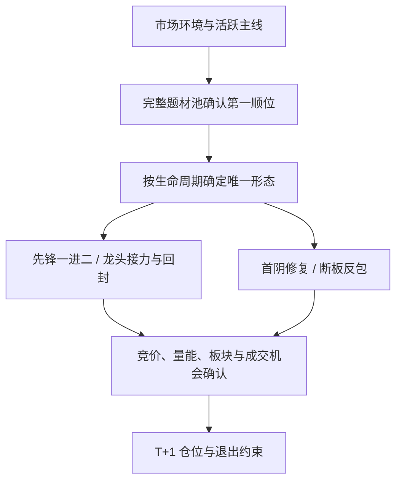

# 策略盘点与主线龙头统一策略

日期：2026-10-14。数据源：mootdx。本文依据生产目录查询、当前候选引擎和历史研究产物。

## 结论

运行目录收敛为 **主线龙头统一策略**（`banxia-mainline-leader-fusion`）。先判定市场是否允许参与，再选活跃主线、确认题材第一顺位，最后根据龙头所处阶段生成一份次日计划。

十个原始策略保留身份、参数模板和历史记录，其中低位首板、题材补涨、容量趋势退出运行目录。原先的自定义策略和模拟盘记录作为历史参考保留。不会把旧策略的回测结果、封板命中率或胜率转移到新策略。

## 当前系统里每个策略在做什么

生产调整前有 12 条策略定义：10 个内置原型、1 个自定义版本、1 个冻结模拟盘版本。真实激活的是名为 **121** 的自定义一进二版本；内置一进二被改名为 **12**，并未激活。

| 策略原型 | 当前选股及确认逻辑 | 优点与缺口 | 合并处理 |
| --- | --- | --- | --- |
| 一进二弱转强 | 昨日首板，首封不晚于 10:30、换手 3%–15%；次日首分钟涨幅 ≥6.5%，09:43 前等待触板后的有量开板窗口 | 入场规则较具体，有独立研究；原逻辑只证明首板质量，没有证明其为题材龙头 | 保留为“主线先锋一进二”，先要求主线内第一顺位，且不存在更高连板龙头 |
| 主线龙头接力 | 原型要求题材至少 2 只涨停，连板接近题材最高；默认最低 3 板、成交额至少 10 亿元 | 最贴近龙头打法；“距最高板差一板”会接纳跟风，成交额固定下限也会排除部分龙头 | 作为统一策略主体；身份改为完整题材池第一顺位，合格后才检查质量 |
| 低位首板挖掘 | 首板，20 日价格位置 ≤70%，20 日涨幅 ≤30%，再检查流动性及题材集群 | 可发现早期机会，但“低位”不能证明领涨身份 | 退出运行，保留历史模板 |
| 分歧转一致回封 | 涨停且至少有一次开板，炸板次数受控，偏重封板持续性 | 描述的是入场形态；任何跟风股也可能回封 | 融为龙头接力的“分歧回封”形态，必须先通过龙头身份 |
| 龙头首阴低吸 | 昨日连续涨停至少 2 板，今天断板收阴，次日放量站回开盘价与昨收 | 有生命周期含义；原判定没有题材领先证据，“曾连板”不足以称龙头 | 保留“龙头首阴修复”；此前至少 3 板、在最近涨停日为题材第一，且未被同高度新龙头替代 |
| 断板反包 / N 字 | 断板 1–3 日，收阳并突破前日高点，次日再确认关键价突破 | 有二次走强含义；原逻辑可接纳普通涨停股，第二、三日的“昨日连板数”会归零 | 保留“龙头断板反包”；用最近涨停的真实日期回查当日身份，不能仅依赖昨天是否连板 |
| 题材卡位补涨 | 题材已有至少 3 板高度，选择低位首板 | 顺周期跟随机会，但补涨股不等于龙头 | 退出运行；没有明确成为第一顺位的证据就不参与 |
| 容量趋势主升 | 未涨停，5 日均线高于 10 日均线，接近 20 日高点，20 日涨幅 5%–35%，成交额较大 | 可用于趋势交易；属于另一套持有周期与退出逻辑 | 退出运行，不与连板龙头的计划混用 |
| 情绪冰点超跌修复 | 距涨停 1–5 日、回撤后收阳修复，市场评分 <65 | 可描述情绪阶段；原筛选范围包含普通强势股，市场越弱并不必然更有优势 | 情绪指标保留为环境门槛；不保留“市场差就买超跌股”的独立策略 |
| 竞价爆量半路确认 | 昨日首板；次日竞价 1%–5%，09:50 前涨幅到 5%、分钟量比 ≥1.5 | 入场方式更早；分钟量比并不等于真实竞价量，也不能证明领涨身份 | 竞价、首分钟和量能作为确认条件，取消独立“半路”策略 |

### 另外两条定义与 L7 管线

- **121**：自定义一进二，最低评分 50、最多 10 只、换手 2%–50%、10:00 截止，首分钟强度门槛关闭。参数比内置版本宽，仍没有龙头身份门槛。调整前有 249 个交易日记录；全部保留为历史参考。
- **一进二正收益模拟盘 V1**：冻结的一进二验证版本，独立 campaign 为 `first-board-positive-v1`，目标 30 笔新增有效结算。调整前有 5 个策略日记录，campaign 新增结算为 0/30。保留其冻结参数与研究连续性，移到模拟盘参考目录。
- **fusion-l7-v1**：是另一条模拟盘 campaign，不是目录中的第 13 个策略原型。它扫描 D1 涨幅 >3% 的未封板股票，组合尾盘偏弱、D2 缺口和分钟级退出；没有明确的主线龙头身份验证。T+1 修正后累计收益 **-16.62%**，21 个月仅 7 个正收益月。取消新增候选及入场，已有仓位仍可结算，保留历史结果。它与本次“主线龙头统一策略”是不同模型。

除内置一进二及其参数版本外，其余 9 个原型在调整前均无策略日记录；存在代码和名称不代表已完成收益验证。此前一进二研究中的 23 笔样本、82.61% 正收益比例，也不能证明新统一策略有同样表现。

## 统一策略如何运行

### 共同前提

1. 市场评分至少 **48**；炸板池不可用时暂停新增候选。
2. 题材当日至少 **2** 只涨停，最近 5 个有数据的涨停池中至少 **2** 日活跃，涨停家数相对均值不收缩。
3. 按当日涨停家数、增量、连板高度排序，选前 **2** 个合格题材。
4. 在完整题材涨停宇宙中，依次比较连板高度、首封时间、成交额，确认第一顺位。龙头被流动性、市值或炸板过滤时，该题材可以没有候选，不递补跟风股。
5. 再检查主板、非 ST、成交额 2 亿–100 亿元、换手 2%–28%、流通市值 15 亿–300 亿元、炸板最多 3 次及评分至少 50。

### 唯一生命周期分支

| 形态 | 身份及形态要求 | 次日计划 |
| --- | --- | --- |
| 主线先锋一进二 | 题材第一顺位为首板，首封不晚于 10:30、换手 3%–15%；首封时间缺失则不确认先锋 | 竞价 0.5%–5%，首分钟 ≥6.5%，09:43 前观察触板后的有量开板窗口 |
| 主线龙头接力 | 题材第一顺位，当前至少 2 板 | 统一竞价区间 -1%–4%，10:00 前观察触板、量能与承接 |
| 龙头分歧回封 | 已确认龙头接力，且当日有开板记录 | 在同一接力计划内标注回封形态；盘中最多 1 次炸板及封稳需要人工核验 |
| 龙头首阴修复 | 最近涨停日为题材第一、当时至少 3 板；次日断板收阴；当前新领涨股未达到此前高度 | 10:00 前放量站回开盘价和昨收；允许开盘后先在昨收下方运行，未站回不确认 |
| 龙头断板反包 | 最近涨停日的龙头证据相同；断板 1–3 日，收阳突破前日高点，且未被同高度新龙头替代 | 10:00 前分钟量比 ≥1.5 并突破计划高点 |

每只股票只归入一个分支，报告保存 `setup`、入场模式、主线排名、当前龙头代码、前期龙头日期和高度。当前最多观察 **3** 只、同题材 **1** 只，单票仓位上限 **15%**、组合 **30%**。这些是观察期保守规则，不是优化得出的最优参数。

退出遵守 A 股 T+1：新买入仓位最早下一交易日卖出；4% 成本回撤为风险预警，不能假设当日执行止损，也不能保证跌停时成交。统一策略当前使用次日溢价、题材退潮的人工退出规则，尚未形成可独立验证收益的完整自动成交模型。

## 数据边界与验证口径

- 日线和历史涨停池只能提供龙头身份的量化代理。盘中卡位、情绪转折、辨识度和真实成交排队仍需核验；报告不会把评分高直接写成确定的市场龙头。
- 历史首封、封单缺失会影响顺位证据和评分。先锋分支要求已知首封，不能把缺失数据当作早封。
- 价格及最近涨停日期只读分析日及之前的 K 线；概念归属和流通股本在现有 mootdx 链路中可能来自较新的快照，缺少完整时点历史。历史回放须标注这一限制，不能据此声称无前视的收益验证。
- 原 10 个原型仍可用于复查，默认 API 与界面只显示 1 条运行策略；`scope=all` 可查看全部历史参考。数据库约束阻止重新激活旧策略或增加第二条运行策略。
- `first-board-positive-v1` 是保留的冻结对照实验，其结果单独展示；新统一策略不会继承其样本。

## 实现与验收依据

- [原始策略逻辑](../src/banxia_strategy/strategy_archetypes.py)、[统一龙头身份与形态](../src/banxia_strategy/leader_strategy.py)、[候选引擎及计划](../src/banxia_strategy/strategy.py)。
- [目录收敛迁移 024](../migrations/postgres/024_unified_leader_catalog.sql)、[目录适配器](../src/banxia_strategy/adapters/strategy_catalog.py)、[目录 API](../src/banxia_strategy/api.py)。
- [龙头规则测试](../tests/test_leader_strategy.py)、[数据库隔离与目录测试](../tests/test_multi_strategy.py)。
- [L7 T+1 重算报告](27-fusion-l7-t1-correction.md)、[生产架构审计](28-architecture-audit-20261014.md)。

验收重点：运行目录仅一条、旧历史记录数量不减少、旧策略不可再次激活、真实龙头被过滤后不晋升跟风股、首阴与反包身份按最近涨停日期追溯、分支规则写入不可变计划、T+1 限制保持。

已完成的本地验证：

- 使用生产目录快照建立隔离 PostgreSQL 测试库，执行 001–024 迁移；升级前后 498 条原策略日记录数量相同，只有统一策略处于运行和激活状态。
- 含 PostgreSQL 隔离检查的完整测试集共 333 项：332 项通过、1 项多组件集成测试未运行。
- Linux amd64 发布镜像内运行完整测试集：313 项通过、20 项数据库或多组件集成测试未运行；数据库检查已在上述隔离库单独完成。
- 发布镜像与工作区 `src` 全部源文件哈希一致：`561b0a3217cf660f12136d52752afa8fe1b8e569ffb8fdfef04062426dcb083f`。镜像标签为 `leader-20261014-r2`。

## 生产发布验收

2026-10-14 早间已完成生产目录迁移和应用滚动发布：

- PostgreSQL 迁移账本已到 `024_unified_leader_catalog.sql`。13 条定义中只有 `banxia-mainline-leader-fusion` 为运行且激活状态；其余 12 条为历史、退役或模拟盘参考。
- 迁移前后旧策略日记录逐策略数量一致：内置一进二 244 条、自定义 121 为 249 条、冻结模拟盘 5 条，总计 **498 条**。新统一策略的日记录独立生成。
- 实际生产 API 默认目录返回 1 条，`scope=all` 返回 13 条，旧自定义策略历史日接口返回 HTTP 200。
- API、行情采集、市场数据落库、参考同步、策略执行、outbox 和投影服务以及 4 个 CronJob 均更新到 `leader-20261014-r2`。现有副本数保持；常驻应用全部就绪。
- 注册表与生产 API Pod 镜像摘要一致：`sha256:3f9f75c7db10a0c307a5d250f16f8506cc73d98c3b89d99c9b747afdbc91cc0b`。策略源码提交为 `895a0253bc51df361eb53307152462e1f665f704`。
- 显式从运行 ConfigMap 注入应用容器的 `BANXIA_CODE_COMMIT`，避免旧 Secret 中同名字段覆盖发布版本标记；新报告与服务使用本次源码提交。
- `fusion-l7-v1` 已取消新增样本；`first-board-positive-v1` 保持独立运行。公网存活与就绪接口返回 HTTP 200，PostgreSQL、Redis、Kafka、ClickHouse 检查均正常。
- 验收报告任务 `banxia-leader-report-20261013-verified` 已成功完成。报告分析日为 **2026-10-13**、计划交易日为 **2026-10-14**，数据源 mootdx；报告 JSON、10 月 13 日次日计划和 10 月 14 日执行计划中的源码提交均为上述 `895a025…`。
- 该次报告市场评分 76.4，产生两只观察候选：乡村振兴的丽人丽妆（605136，`leader_relay`）和储能的理工能科（002322，`leader_start`）。两者分别来自第 1、2 顺位主线，均保存第一顺位证据和 `t1_required=true`。这是规则与链路验收样本，尚未发生入场或结算。

发布仅验证策略规则、数据链路和目录收敛，不代表已经验证统一策略的盈利能力。
