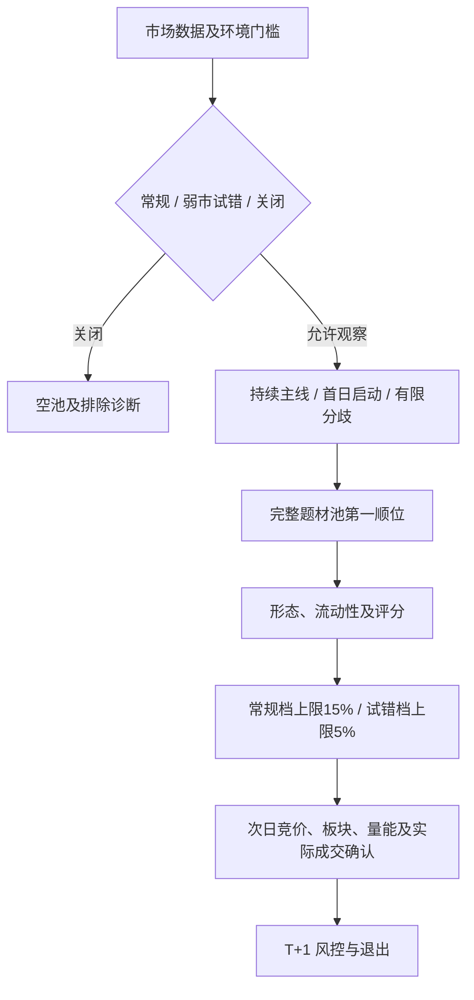

# 主线龙头 V2：扩大观察池，按阶段限制仓位

日期：2026-10-15。线上现状取自 rustdx 发布后的目录与报告；最近完整交易日为 2026-10-14。本文交付一版可运行的策略规则、显式升级迁移、V1 对照配置及真实数据比较。

## 判断与交付结论

当前 V1 对“启动”和“分歧”过于一刀切，但不能据此判断越宽松越好。10 月 14 日环境分 **45.3**，低于统一门槛 48，所有候选在市场层被关闭；题材家数必须不低于近期均值、至少活跃两天，也会排除新题材首日集群和部分仍保留龙头的分歧阶段。

实现 **V2 分档观察版**：保留持续主线的接力规则，增加首日启动、有限收缩及弱市低板观察，新增机会使用 **5%** 单票上限。仍先在完整题材池确认第一顺位，再检查成交额、市值与形态；龙头不合格时不递补跟风股。

33 日对比显示空池减少，但整体次日封板比例下降。V2 扩展档尚无证据支持常规仓位，更没有证明盈利改善。历史 V1 模拟盘及其冻结计划保持原规则，不继承或混入 V2 结果。

## 网上龙头打法如何转成规则

网上交流提供的是交易经验，以下材料均不视为有效收益证据，也不采用其中未经核验的收益数字或名人归因。

| 经验线索 | 可核验的规则代理 | 使用边界 |
| --- | --- | --- |
| 分歧后的弱转强，仍需题材延续 [S1](#S1) | 题材当日至少 2 只涨停、至少两日活跃；家数不低于此前均值的 50%，当前高度至少 2 板 | 仅描述“有限分歧”；单票 5%，不在该阶段做首阴或反包 |
| 孤立弱转强在板块或市场恶化中可能失败 [S2](#S2) | 同题材样本、上涨比例与承接确认保留；炸板率达到 55% 关闭；弱市不做四板及以上接力或断板修复 | 市场差本身不构成买入理由 |
| 启动、发酵、分歧、退潮应分阶段参与 [S3](#S3) | 首日题材至少 3 只涨停且增量为正；启动、新题材、分歧与第三题材使用小仓 | 家数门槛及仓位均是待验证的工程参数 |
| A 股当日买入不能假定当日卖出 [S4](#S4) | 计划冻结 `t1_required=true`，保留隔日退出及无法成交的边界 | 4% 是成本回撤预警，不能当成保证成交的日内止损 |

这套系统只量化连板、首封、成交额和题材广度等代理。盘中卡位、辨识度、竞价强弱、封稳和实际排队成交仍不能由收盘数据完整证明。

## V1 与 V2 参数

| 项目 | V1 | V2 |
| --- | --- | --- |
| 常规市场门槛 | 环境分 ≥48，炸板池可用 | 保留；另要求炸板率 <55% |
| 弱市观察 | 环境分不足 48 全部关闭 | 分数 40–不足 48、炸板率 ≤45%、市场高度 ≥3 板，三者同时满足才开放 |
| 弱市形态 | 无 | 仅首板启动与 2–3 板接力；不做四板以上及首阴反包 |
| 持续主线 | 家数不收缩，活跃至少两天 | 保留 |
| 新题材 | 首日不合格 | 首日至少 3 只涨停且增量 >0，小仓观察 |
| 有限分歧 | 家数负增量全部排除 | 家数至少 2、活跃至少两天、今日家数 / 此前均值 ≥50%、高度 ≥2 板 |
| 题材范围 | 前 2 个合格题材 | 前 3 个；第三题材归试错档 |
| 启动首封 / 换手 | ≤10:30；3%–15% | ≤14:00；2%–25%；首封缺失仍拒绝 |
| 启动次日竞价 / 首分钟 | 0.5%–5%；首分钟 ≥6.5% | 0%–5%；首分钟 ≥3% |
| 启动入场截止 | 09:43 | 10:00；仍等待首次触板后的有量开板窗口 |
| 最低综合评分 | 50 | 45 |
| 单票上限 | 15% | 前两条持续主线中的接力/合格修复 15%；所有启动、新题材、有限分歧、第三题材和弱市 5% |
| 组合 / 数量 | 30%；最多 3 只，同题材 1 只 | 保留；仓位为上限，非建议满仓目标 |

实际配置见 [V2 默认文件](../config/strategy.json) 与 [V1 对照文件](../config/leader-v1.json)。比例的分母是回看池中**此前各日家数的均值**，并非仅与昨日比较。活跃天数在最近五个有数据的涨停池中计算；它不代表连续五日活跃。

主板、非 ST、成交额 2 亿–100 亿元、换手 2%–28%、流通市值 15 亿–300 亿元、历史炸板最多 3 次，以及缺失封单扣 6 分均保留。不得填造封单或财务数据使标的通过筛选。



## 真实数据比较

### 样本与方法

- 使用已有真实研究快照，回放 **2026-08-11 至 2026-09-24 共 33 个交易日**。该快照来自已归档的 mootdx 采集，不重新启用退役数据源。
- 将每个分析日的股票宇宙、回看涨停池、市场状态及题材统计预先按日期保存；V1/V2 使用相同输入。逐日断言重构后的 V1 候选代码及顺序与修改前一致，33 日全部通过。
- 另用当前 rustdx 重新采集 2026-10-14 数据，在同一个 **235 只**归一化候选宇宙上比较；线上原报告宇宙为 239 只，不能把两次采集差异当成参数效果。
- 没有通过参数网格搜索挑出收益较高的组合。首次扩大观察池后发现封板比例下降，因此限制扩展分支仓位；仓位分档本身也尚待前向验证。
- “候选次数”按日期与股票计数，同一股票跨日可重复；比例分母仅包含可取得下一交易日收盘的样本，不是独立交易笔数。

| 指标 | V1 | V2 |
| --- | ---: | ---: |
| 交易日 | 33 | 33 |
| 候选次数 | 33 | 54 |
| 不同股票 | 28 | 43 |
| 空池天数 | 8 | 3 |
| 次日收盘可观察样本 | 32 | 53 |
| 次日收盘仍封板 | 18 | 20 |
| 次日收盘封板比例 | 56.25% | 37.74% |

V2 增加 22 次原 V1 未入选的观察，同时有 1 次 V1 候选因题材重排未进入 V2，净增 21 次；V2 不是 V1 的严格超集。

| V2 仓位分档 | 候选次数 | 可观察样本 | 次日收盘封板 | 比例 |
| --- | ---: | ---: | ---: | ---: |
| 常规档：上限 15% | 28 | 27 | 17 | 62.96% |
| 试错档：上限 5% | 26 | 26 | 3 | 11.54% |

常规档的 28 次候选均来自 V1 原有候选。这是对已有逻辑做风险分类后的子集，不能把 62.96% 宣称为独立优化提升；试错档表现明显较弱，支持保守观察而非扩大仓位。

分月也没有消除这个问题：8 月 V1 为 8/13（61.54%），V2 为 10/21（47.62%）；9 月 V1 为 10/19（52.63%），V2 为 10/32（31.25%）。一段有限样本不能证明跨周期稳定性。

**这些全部是选股代理指标，不是胜率、实际成交率或策略收益。** 下一交易日的上涨可能发生在买入之前；D2 买入后必须到 D3 才能卖出，不能把 D1 收盘至 D2 收盘的价格变化当作可实现收益。两版均缺少 9 月 24 日奥佳华（002614）的次日收盘，因此分别从比例分母剔除 1 次。

### 最近交易日

2026-10-14：环境分 45.3，涨停 40 只、炸板 29 只，炸板率 42%，市场高度 4 板。V1 为 0；V2 满足弱市试错条件，形成 **航发科技（600391）**一只观察候选：

- 高端装备题材第 3，题材当日 2 只涨停、近五池活跃 4 日；个股当前 2 板，完整题材池第一顺位。
- 成交额约 7.83 亿元，换手约 5.79%；评分 61.8。历史封单缺失仍扣分。
- 单票上限 5%；次日竞价 -1%–4%，同题材至少两个有效样本且上涨比例 ≥50%；10:00 前量能、回封与实际成交机会仍需核验。
- 储能第一顺位冰山冷热成交额约 1.14 亿元，低于 2 亿元下限，排除且不递补；IP 经济第一顺位慈文传媒为 4 板，弱市阶段排除。

同一输入共有 234 只被排除：题材层 179、形态层 43、身份层 11、质量层 1。结构化诊断已进入日报 JSON、Markdown 和报告 API，便于区分市场关闭、题材不足、非龙头、形态不符、质量、评分及数量限制。

### 数据限制

旧快照含 3307 只股票宇宙、3196 只有日线历史；111 只缺历史。股票名称、题材分类与流通股本来自采集时快照，存在时点偏差和幸存者偏差，不能称为无前视回测。价格与身份池按分析日读取，不使用之后的 K 线选股。

历史封单不可核验。非涨停修复行在现有归档快照中缺流通市值/财务信息，质量过滤会排除，因而本次两版均未产生首阴或反包样本；这两个分支只有规则测试，缺少历史表现证据。收盘封板代理采用主板普通 10% 涨停的分币价格，特殊交易制度、秒级封稳、盘口排队、滑点和真实成交均不在该指标内。

## 实现、复现与上线状态

- [规则与身份](../src/banxia_strategy/leader_strategy.py)：`leader_rule_version` 缺省为 1，旧快照沿用 V1；V2 的市场模式、题材阶段、风险原因与仓位随计划冻结。
- [候选引擎](../src/banxia_strategy/strategy.py)：候选仓位、退出文案及嵌入计划一致；报告保存分层排除诊断。
- [迁移 026](../migrations/postgres/026_mainline_leader_v2.sql)：显式升级运行目录，限定当前规则为 V1；重复执行不覆盖后续 V2 调整。不修改历史版本、旧计划、V1 paper 身份或 campaign 快照。
- [完整对比 JSON](data/leader-v2-comparison-20261015.json)：配置、原快照与归一化输入哈希、逐日候选、仓位分档、来源质量及汇总指标。
- [比较脚本](../scripts/compare_leader_versions.py)：可接受按日期的归一化帧及原始快照，检查 V1 回归和原始输入哈希。

```bash
PYTHONPATH=src .venv/bin/python scripts/compare_leader_versions.py \
  --frames /tmp/agent-leader-v2-replay-input.json \
  --latest /tmp/agent-leader-v2-latest-input.json \
  --outcome-snapshot reports/strategy-history/20260811-20260924/snapshot.json \
  --output docs/data/leader-v2-comparison-20261015.json
```

上述归一化输入是本次研究的临时缓存，最终 JSON 保存哈希与结果；要重新生成输入，需按原分析日用 `DatedResearchProvider` 或 rustdx 获取股票宇宙及回看池，不能以当前数据替代历史日期。

本地验收包括 V1 规则回归、弱市边界、严重退潮关闭、新题材与分歧边界、第三题材及启动仓位、拒绝递补跟风、报告/API 诊断及计划冻结。隔离 PostgreSQL 执行 001–026 迁移并校验升级幂等、旧版本与计划保持、V1 模拟盘快照不变；生产 Kustomize 清单渲染通过。

交付源码快照的完整测试集 **387 项，386 项通过，1 项多组件集成跳过**；上述 PostgreSQL 隔离测试实际执行通过，临时测试数据库已删除。交付快照的 Kustomize 清单也独立渲染通过。

**本次仅完成本地规则、配置、迁移与研究交付，尚未发布新的生产镜像或在生产执行 026。** 线上现有 V1 前向实验继续按冻结规则累计；V2 的盈利改善需独立、遵守 T+1 的前向成交与结算验证。

## 来源

查阅日：2026-10-15。S1–S3 为社区经验材料；S4 为交易所规则。

<a id="S1"></a>**S1**：[淘股吧：分歧后弱转强与题材延续讨论](https://m.taoguba.com.cn/Article/6250983/12)。

<a id="S2"></a>**S2**：[淘股吧：孤立弱转强及市场恶化的反例讨论](https://www.taoguba.com.cn/Article/7626268/1)。

<a id="S3"></a>**S3**：[韭研公社：情绪阶段与仓位参与讨论](https://www.jiuyangongshe.com/a/2z9jl86hs5z)。

<a id="S4"></a>**S4**：[深圳证券交易所交易规则（2026 年修订）](https://docs.static.szse.cn/www/lawrules/rule/trade/W020260424690713155663.pdf)，第 3.1.4 条关于交收前卖出与允许回转交易的例外。
