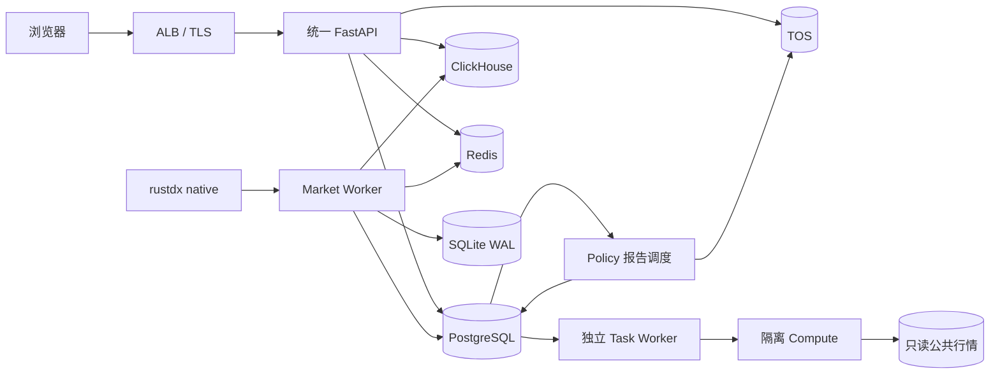

# v0.5.1 精简生产架构

## 1. 目标

`v0.5.1` 将 `v0.5.0` 的双产品域和流式平台收敛为适合当前业务规模的模块化架构。
目标是在不降低行情时效、事务一致性、租户隔离和审计能力的前提下，缩短调用链、减少
常驻进程和单点组件。

本版本仍是行情研究与策略辅助系统，不连接券商账户，不生成或发送真实委托。

## 2. 当前架构

### 2.1 常驻工作负载

| 工作负载 | 职责 | 副本 |
| --- | --- | ---: |
| `tsp-product` | React 静态资源、统一 API、账户、多租户、SSE | HPA 2～4 |
| `tsp-task-worker` | TSP 研究、实时规则、通知、定时任务 | 1，Recreate |
| `report-scheduler` | Policy 刷新队列、历史生成、定时报告与补跑 | 1，Recreate |
| `tsp-platform` | 公共行情版本与平台配置 | 1 |
| `tsp-compute` | 无密钥、禁止出网的受限计算进程 | 1 |
| `market-collector` | `market-worker` 入口，行情、特征、策略和投影 | 2，租约单活 |
| `market-reference-sync` | 证券、板块和参考数据同步 | 1 |

研究、实时规则、通知和定时任务由独立 `tsp-task-worker` 统一监督。API 扩容不会
复制后台进程。任一子进程异常退出时，
容器失败并由 Kubernetes 重建，避免部分 Worker 无声失效。
Policy 定时报告与页面刷新共用 `report-scheduler`，不再额外运行 16:30/23:30 报告
CronJob。重启后本地完成标记丢失时允许幂等重算，不能仅凭已保存的计划判定对象归档已完成。
Market Worker 启动及候选刷新直接读取数据库计划，不挂载报告目录。

### 2.2 数据职责

| 数据 | 权威存储 | 说明 |
| --- | --- | --- |
| 用户、租户、策略、计划、状态、任务、审计 | PostgreSQL | 同一集群，独立数据库和最小权限角色 |
| 盘口、分钟线、特征和历史行情 | ClickHouse | 批量、幂等写入 |
| 最新行情、最新决策、SSE 投影 | Redis | 可重建，不作为事实来源 |
| 原始文件、报告和研究资产 | 火山引擎 TOS | 使用上海地域 S3 兼容内网端点 |
| 尚未完成持久化的行情事件 | 每个 Market Worker 的 SQLite WAL | 全部下游成功后删除 |

## 3. 精简内容

生产主路径不再部署以下组件：

- 独立 Policy API Deployment 和集群 HTTP Policy Bridge。
- 独立 TSP PostgreSQL StatefulSet。
- Kafka、Flink、`market-sink`、`strategy-engine`、`outbox-relay` 和
  `projection-worker` 常驻工作负载。
- 自建 MinIO 和 Policy 报告 NAS。
- 独立 SSE Gateway。
- Pod 内 DinD 和特权容器。

旧 Kafka/Flink 适配器、Worker 入口、依赖、Compose 服务、Kubernetes 定义和排除补丁
均已从当前源码删除。本地 Policy Compose 使用相同 Market Worker；MinIO 只作为本地
S3 模拟器保留。回滚使用 Git 历史与旧镜像，不能用新镜像运行已退役入口。
品牌预览、开发演示及其数据生成/强制预警接口、第三方开源版本轮询已退役。
具体范围及验证见 [生产精简记录](37-production-simplification.md)。

## 4. 一致性设计

Market Worker 对单个行情事件按以下顺序执行：

1. 事件先写入本 Pod 的 SQLite WAL。
2. 原始盘口或分钟线幂等写入 ClickHouse。
3. 更新 Redis 行情投影。
4. 在进程内计算确定性实时特征，并写入 ClickHouse 和 Redis。
5. 策略状态机在 PostgreSQL 事务内写 Inbox、状态、事件和 Outbox。
6. 权威存储成功后删除 WAL 事件。
7. Market Worker 内的 Outbox Relay 更新 Redis 决策投影；失败时保留 Outbox 并重试。

失败时 WAL 保留并在下一轮重放。PostgreSQL Inbox 和稳定事件 ID 阻止重复状态迁移。
Redis 丢失不影响权威数据，可从 PostgreSQL 和 ClickHouse 重建。

## 5. 计算隔离

`tsp-compute` 不包含数据库、SMTP、对象存储或平台管理凭据，并采用：

- 独立 Pod 和 Service。
- 默认拒绝全部出站网络。
- 只读根文件系统。
- 只读公共行情卷。
- 非 root 用户、无 Linux capabilities。
- 固定并发、CPU 和内存上限。

Task Worker 通过集群内 TCP 使用原有 JSON 行协议；API 只做健康探测。
网络策略仅允许这两个工作负载访问 Compute。相比 DinD，该方案消除了特权容器和 Docker
Socket，同时保留进度流、取消和大结果返回能力。

## 6. PostgreSQL 合并

Policy、TSP 控制库和 TSP 业务库使用同一个 PostgreSQL 集群：

- `banxia`：Policy 业务。
- `tsp_control`：身份、租户和路由。
- `tsp_data_production`：租户业务数据。
- `tsp_control_runtime` 与 `tsp_data_runtime` 使用不同密码、禁止继承和
  `BYPASSRLS`。

已有生产数据必须先执行
`product/deploy/kubernetes/migrate-legacy-postgres.yaml`，验证行数和登录后才能删除旧
`tsp-postgres` StatefulSet。禁止直接删除旧 PVC。

## 7. 发布顺序

1. 备份 Policy PostgreSQL、旧 TSP PostgreSQL、ClickHouse、MinIO 和 NAS。
2. 创建 TOS Bucket，迁移对象并验证 SHA-256。
3. 更新 `banxia-secrets` 的 TOS AK/SK，更新 TSP 新旧数据库 DSN。
4. 应用 `tsp-database-bootstrap`，创建数据库和两个运行角色。
5. 执行旧 TSP PostgreSQL 迁移 Job，并完成数量和抽样校验。
6. 构建并推送 `v0.5.1` Policy、Web Runtime 和 Compute 镜像，固定 digest。
7. 服务端 dry-run 后，先暂停旧报告 CronJob 并确认存量作业结束，再发布新清单。
   旧 API 侧车与新 Task Worker 在滚动窗口内依靠持久任务租约协调；发布完成后确认
   所有旧 API Pod 已退出，只保留一组后台进程。
8. 验证统一登录、九项菜单、Policy 页面、
   手动报告刷新、SSE、Market Worker 和 Compute。
9. 验收后删除旧工作负载和 Service，保留旧 PVC/Bucket 至少五个交易日。
10. 观察期和恢复核对完成后，再审批回收旧 PVC、Bucket 与兼容配置。

## 8. 扩展阈值

只有满足以下任一条件时才重新引入 Kafka：

- 持续事件量超过 `10,000 events/s`。
- 实时事件出现三个以上相互独立的消费域。
- 需要超过 24 小时的在线重放。

只有窗口计算无法在 Market Worker 资源预算内稳定完成，或出现多作业共享状态需求时，
才重新引入 Flink。扩容依据必须来自压测和生产指标，不能仅依据预期增长。
